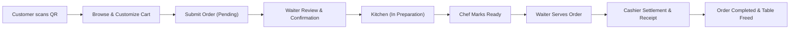

# 🍽️ Restaurant Management & QR Ordering System

A comprehensive, full-stack ASP.NET Core solution designed for modern restaurants. This system delivers end-to-end restaurant automation, featuring contactless QR-code dining, real-time live kitchen and waitstaff dashboards via SignalR, multi-branch management, POS cashier shifts, recipe & inventory tracking (ERP), and business analytics.

---

## 📑 Table of Contents

- [Overview](#-overview)
- [Key Features](#-key-features)
  - [Customer QR Experience](#1-customer-qr-experience)
  - [Real-Time Staff Operations](#2-real-time-staff-operations-signalr)
  - [POS & Cashier Management](#3-pos--cashier-management)
  - [Inventory & Recipe Costing (ERP)](#4-inventory--recipe-costing-erp)
  - [Administration & Multi-Branch Support](#5-administration--multi-branch-support)
  - [Analytics & Financial Reporting](#6-analytics--financial-reporting)
- [Architecture & Tech Stack](#-architecture--tech-stack)
- [Project Structure](#-project-structure)
- [Getting Started](#-getting-started)
  - [Prerequisites](#prerequisites)
  - [Installation & Setup](#installation--setup)
  - [Configuration](#configuration)
  - [Database Migrations](#database-migrations)
  - [Running the App](#running-the-app)
- [Default Staff Accounts](#-default-staff-accounts)
- [Role-Based Access Control](#-role-based-access-control)
- [Order Lifecycle Flow](#-order-lifecycle-flow)
- [License](#-license)

---

## 🌟 Overview

The **Restaurant Management System** eliminates traditional communication bottlenecks between diners, front-of-house staff, and kitchen crews. Diners can sit down, scan a dynamic table QR code, browse rich visual menus, customize meals with add-ons and sizes, and place orders directly. Orders instantly propagate in real time to waiters, chefs in the kitchen, and cashier counters.

---

## 🚀 Key Features

### 1. Customer QR Experience
- **Dynamic QR Code Generation:** Automated generation of high-resolution QR codes mapped to physical tables (stored via Cloudinary).
- **Session-Based Dining:** Diners join automated table sessions without needing to sign up for an account.
- **Smart Recommendations & Add-Ons:** Visual badges (*Best Seller*, *Trending*, *Chef Recommended*), size variations (e.g., Small, Medium, Large), and optional add-ons (extra sauce, extra cheese).
- **Live Order Tracking:** Customers monitor order preparation status live using their table session or phone number.
- **Bilingual Interface:** Support for English and Arabic.

### 2. Real-Time Staff Operations (SignalR)
- **Waiter Dashboard (`/Waiter`):**
  - Instant audio-visual alerts when diners place an order or request assistance.
  - Verification and approval of incoming customer orders before sending them to the kitchen.
  - Table session management and manual session closing.
- **Kitchen / Chef Display System (`/Chef`):**
  - Live kitchen display grouping orders by active preparation states.
  - Single-click action to transition meals: `In Preparation` ➔ `Ready`.
  - Detailed line-item customizations, guest notes, and add-on displays.

### 3. POS & Cashier Management (`/Cashier`)
- **Shift Management:** Cashier shift lifecycle management (Open Shift, Cash in Hand, Expected vs. Actual Cash Reconciliation, Close Shift).
- **Checkout & Settlement:** Process payments (Cash, Credit Card, Split / Online), apply discounts, tax calculation, and receipt printing.
- **Table Clearing:** Releases table occupancy and completes transactions.

### 4. Inventory & Recipe Costing (ERP) (`/Inventory`)
- **Raw Ingredient Tracking:** Monitor raw materials, unit costs, minimum stock levels, and expiry alerts.
- **Recipe BOM (Bill of Materials):** Map menu items to raw ingredients with automated inventory depletion upon order fulfillment.
- **Purchase Orders & Stock In/Out:** Log supplier purchases, manual adjustments, waste tracking, and supplier contacts.

### 5. Administration & Multi-Branch Support
- **Multi-Branch Control (`/Branches`):** Organize menus, tables, and staff permissions across different restaurant branch locations.
- **Menu Engineering (`/MenuCategory`, `/MenuItem`):** Dynamic category ordering, item visibility toggles, image uploads, price tiers, and modifier groups.
- **Table & QR Management (`/Tables`, `/QrCodes`):** Configure floor layouts, table numbers, guest capacity, and bulk print QR codes.
- **User & Role Administration (`/Users`, `/Admin`):** Manage staff profiles, system permissions, and credential assignments.

### 6. Analytics & Financial Reporting (`/Analytics`)
- Interactive dashboards with charts for:
  - Daily, weekly, and monthly revenue performance.
  - Best-selling dishes and top-performing categories.
  - Hourly rush-hour trends and peak dining times.
  - Inventory waste, raw material consumption, and profit margin analysis.

---

## 🛠️ Architecture & Tech Stack

This project follows Clean Architecture / N-Tier architectural best practices:

- **Framework:** .NET 10 (ASP.NET Core MVC & Razor Pages)
- **Data Access:** Entity Framework Core (Code-First)
- **Database:** Microsoft SQL Server / LocalDB
- **Real-Time Communication:** ASP.NET Core SignalR
- **Identity & Security:** ASP.NET Core Identity with Role-Based Access Control (RBAC)
- **Media Storage:** Cloudinary DotNet SDK (QR code & menu image hosting)
- **Barcode / QR:** QRCoder
- **Email Service:** MailJet API
- **Frontend / Styling:** Bootstrap 5, FontAwesome, JavaScript (Fetch API & SignalR Client)

---

## 📂 Project Structure

```text
ResturantProject/
├── Resturant.Core/              # Domain entities, DTOs, Enums, Interfaces, and Domain Constants
│   ├── Common/                  # AppRoles, PaginatedList, BaseEntity
│   ├── DTOs/                    # Data Transfer Objects & Report ViewModels
│   ├── Entities/                # Database models (Order, MenuItem, TableSession, ErpModels, etc.)
│   └── Interfaces/              # Repository and service interfaces (IAnalyticsService, etc.)
│
├── Resturant.Infrastructure/    # Data persistence, EF DbContext, Migrations & Cloud Services
│   ├── Data/                    # AppDbContext and DbInitializer
│   ├── Migrations/              # EF Core database migrations
│   └── Services/                # Infrastructure implementations (Cloudinary, MailJet)
│
├── Resturant.Services/          # Business logic implementation
│   ├── Implementation/          # OrderService, MenuService, InventoryService, etc.
│   └── DependencyInjection.cs   # Service container extensions
│
└── Resturant.Web.UI/            # Presentation Layer (MVC Controllers, Hubs, Views & Static Assets)
    ├── Areas/Identity/          # Authentication & Account management
    ├── Controllers/             # Admin, Waiter, Chef, Cashier, Menu, Inventory, Analytics
    ├── Hubs/                    # SignalR Hubs (OrderHub)
    ├── Views/                   # Razor views for staff dashboards & customer interfaces
    ├── appsettings.json         # Configuration file
    └── Program.cs               # App startup, DI configuration, and middleware pipeline
```

---

## 🚀 Getting Started

### Prerequisites

- [.NET 10.0 SDK](https://dotnet.microsoft.com/) or later
- [SQL Server](https://www.microsoft.com/en-us/sql-server/sql-server-downloads) (Express, Developer Edition, or LocalDB)
- [Cloudinary Account](https://cloudinary.com/) (for QR and menu image storage)

### Installation & Setup

1. **Clone the repository:**
   ```bash
   git clone https://github.com/your-username/ResturantProject.git
   cd ResturantProject
   ```

2. **Configure `appsettings.json`:**
   Navigate to `Resturant.Web.UI/appsettings.json` and adjust the connection string and Cloudinary settings:

   ```json
   {
     "ConnectionStrings": {
       "DefaultConnection": "Server=localhost\\SQLEXPRESS;Database=ResturantDb;Trusted_Connection=True;MultipleActiveResultSets=true;TrustServerCertificate=True"
     },
     "CloudinarySettings": {
       "CloudName": "YOUR_CLOUD_NAME",
       "ApiKey": "YOUR_API_KEY",
       "ApiSecret": "YOUR_API_SECRET"
     },
     "MailJet": {
       "ApiKey": "YOUR_MAILJET_API_KEY",
       "SecretKey": "YOUR_MAILJET_SECRET_KEY",
       "SenderEmail": "info@yourrestaurant.com"
     }
   }
   ```

3. **Database Migrations:**
   Run migrations and update your database schema using the .NET CLI:
   ```bash
   cd Resturant.Web.UI
   dotnet ef database update
   ```

4. **Run the Application:**
   ```bash
   dotnet run
   ```
   Open your browser and navigate to `https://localhost:7142` (or the port specified in console output).

---

## 🔑 Default Staff Accounts

On first run, the database automatically seeds standard user roles and a primary Super Administrator account:

| Role | Default Email | Default Password | Permissions / Accessible Area |
| :--- | :--- | :--- | :--- |
| **Admin** | `admin@resturant.com` | `Admin@123` | Full system access, configurations, user management, and ERP |
| **Manager** | *(Create in Admin)* | Custom | Branch management, menu changes, staff scheduling, reports |
| **Waiter** | *(Create in Admin)* | Custom | Waiter Dashboard (`/Waiter`), confirm orders, table sessions |
| **Chef** | *(Create in Admin)* | Custom | Kitchen Display System (`/Chef`), order preparation updates |
| **Cashier / Accountant** | *(Create in Admin)* | Custom | POS Dashboard (`/Cashier`), shifts, settlements, inventory |

> [!IMPORTANT]
> Immediately change default passwords when deploying to production environments.

---

## 🔄 Order Lifecycle Flow



1. **Scan & Browse:** Guest scans the table's QR code, gets redirected to `https://<domain>/Menu?tableNumber={X}`, and builds their order.
2. **Order Placement:** Guest confirms order; status is set to `Pending`.
3. **Waiter Verification:** Front-of-house staff reviews items, verifies the table number, and confirms the ticket.
4. **Kitchen Display:** Kitchen staff receives an audio-visual SignalR notification, begins cooking (`InPreparation`), and flags items `Ready`.
5. **Billing & Settlement:** Waiter delivers food; cashier closes the order via payment processing (`CashierController`), releasing the table session for new diners.

---

## 📄 License

This project is licensed under the terms described in [LICENSE.txt](file:///c:/Users/CM/source/repos/ResturantProject/LICENSE.txt).
